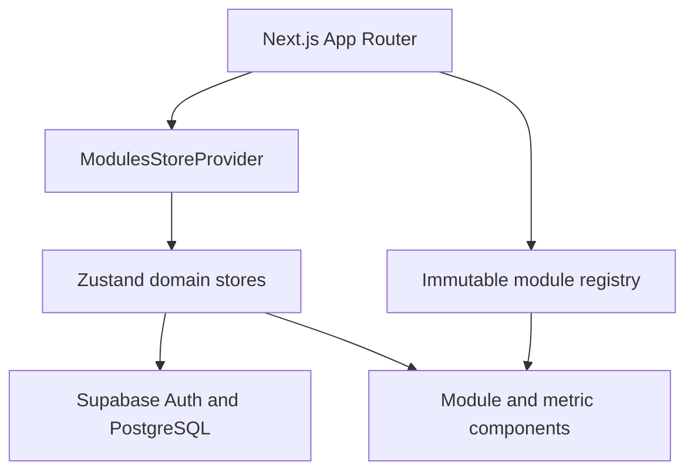

# Amelify

Amelify is a modular personal productivity hub. Users can add productivity
modules to a shared workspace, open a module in a focused view, and use module
metrics to understand their progress.

The project is currently an active Next.js frontend prototype backed by Supabase
authentication and persistence. The planned backend, AI assistant, scoring engine,
and additional infrastructure are not implemented in this checkout.

## Contents

- [Current Features](#current-features)
- [Architecture](#architecture)
- [Technology](#technology)
- [Requirements](#requirements)
- [Setup](#setup)
- [Environment Variables](#environment-variables)
- [Development Commands](#development-commands)
- [Project Structure](#project-structure)
- [Roadmap](#roadmap)
- [License](#license)

## Current Features

### Application Shell and Authentication

- Next.js App Router route groups for authenticated and unauthenticated views.
- Supabase authentication through server and browser clients.
- Authenticated module routes protected by the application layout.
- Shared application shell and sidebar navigation.

### Module Workspace

- Add, remove, and open modules from the Modules workspace.
- Stable module registry backed by `ModuleId` values.
- Add Module is a fixed workspace utility and is not persisted as an active module.
- Active module membership is persisted in the `user_modules` table.
- Module state is stored separately from module definitions.

### Streak Counter

- Current streak calculated from the streak start timestamp using 24-hour periods.
- Best streak tracking.
- Reset action with reset-history persistence.
- GitHub-style reset heatmap.
- Current and best streak metrics for module cards and focused views.

### Available Modules

- **Streak Counter:** tracks reset-based streaks, best streaks, and reset history.
- **Habit Tracker:** initial module scaffold whose feature set is still in development.

## Architecture



### Module Definitions

Module definitions are immutable blueprints registered in
`frontend/configs/add-module-config.ts`. The registry contains concrete module
instances keyed by `ModuleId`:

```ts
export const MODULE_LIST = {
  "habit-tracker": new HabitTrackerModule(),
  "streak-counter": new StreakCounterModule(),
};
```

The module store keeps only primitive `activeModuleIds`. Components resolve the
current immutable definition from `MODULE_LIST` when they render.

The Add Module utility has its own `AddModuleId` and is rendered by the workspace
without being included in the persisted module registry.

### Zustand Stores

Stores are created with Zustand `createStore()` and scoped through
`ModulesStoreProvider`:

- `modules-store.ts` manages active module IDs, focus state, database hydration,
  and module placement changes.
- `metrics-store.ts` manages selected metrics for active modules.
- `streak-counter-store.ts` manages streak values, reset timestamps, best streak,
  and reset history.

The provider receives the authenticated user ID, creates isolated store instances,
and starts store hydration when the authenticated module layout mounts.

### Supabase Data

The current frontend uses two application tables:

- `user_modules` stores which modules are active for each user.
- `user_module_data` stores feature-specific JSONB state, including streak data.

Both tables require appropriate authenticated grants and row-level security
policies that constrain rows to `auth.uid() = user_id`.

## Technology

- Next.js 16 with the App Router
- React 19
- TypeScript
- Tailwind CSS v4
- Zustand 5
- Supabase SSR and browser clients
- Lucide React icons
- ESLint 9 and Prettier

## Requirements

- Node.js 20 or newer
- npm
- A Supabase project with authentication enabled
- Supabase tables and RLS policies for `user_modules` and `user_module_data`

## Setup

From the repository root, install the frontend dependencies:

```bash
cd frontend
npm install
```

Create the local environment file:

```bash
copy .env.local.example .env.local
```

Fill in the Supabase values, then start the development server:

```bash
npm run dev
```

Open [http://localhost:3000](http://localhost:3000).

## Environment Variables

Create `frontend/.env.local` with:

```env
NEXT_PUBLIC_SUPABASE_URL=your_supabase_project_url
NEXT_PUBLIC_SUPABASE_PUBLISHABLE_KEY=your_supabase_publishable_key
```

The publishable key is used by the browser client. Row-level security must protect
database access; do not place a Supabase service-role key in this file or expose it
to the browser.

## Development Commands

Run these commands from `frontend/`:

```bash
npm run dev      # Start the development server
npm run lint     # Run ESLint
npm run build    # Create a production build and type-check the application
npm run start    # Start the production server after a build
```

## Project Structure

```text
.
├── frontend/
│   ├── app/                 # App Router pages, layouts, and route groups
│   ├── components/          # Layout, module, metric, and shell components
│   ├── configs/             # Module and metric registries
│   ├── providers/           # Scoped Zustand store provider
│   ├── stores/              # Domain stores and database hydration
│   ├── types/               # Module, page, card, and metric contracts
│   ├── utils/supabase/      # Server and browser Supabase clients
│   └── public/              # Images and animation assets
├── logbook/                 # Development notes and design decisions
├── scripts/                 # Repository maintenance scripts
├── AGENTS.md                # Agent and architecture guardrails
├── CONTRIBUTING.md          # Engineering conventions
└── LICENSE                  # Project license
```

## Roadmap

Planned work includes:

- Complete Habit Tracker functionality.
- Module settings for selecting visible card and focused-view metrics.
- Additional productivity modules and metrics.
- Life Score aggregation across module data.
- AI-assisted productivity features.
- Expanded backend and deployment infrastructure.

These items are design and development plans, not currently available services in
this repository.

## License

This project is licensed under the MIT License. See [LICENSE](LICENSE) for details.
